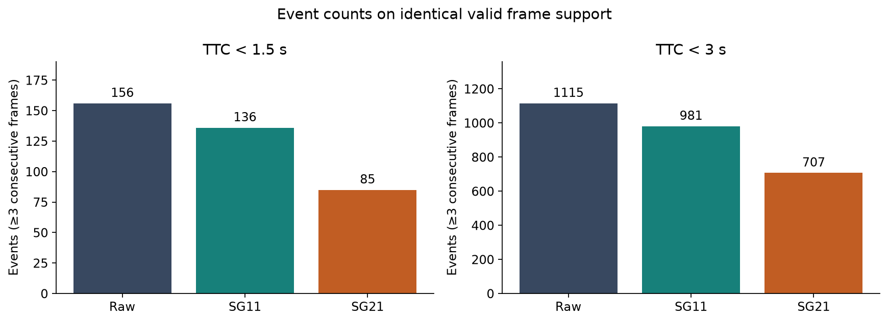
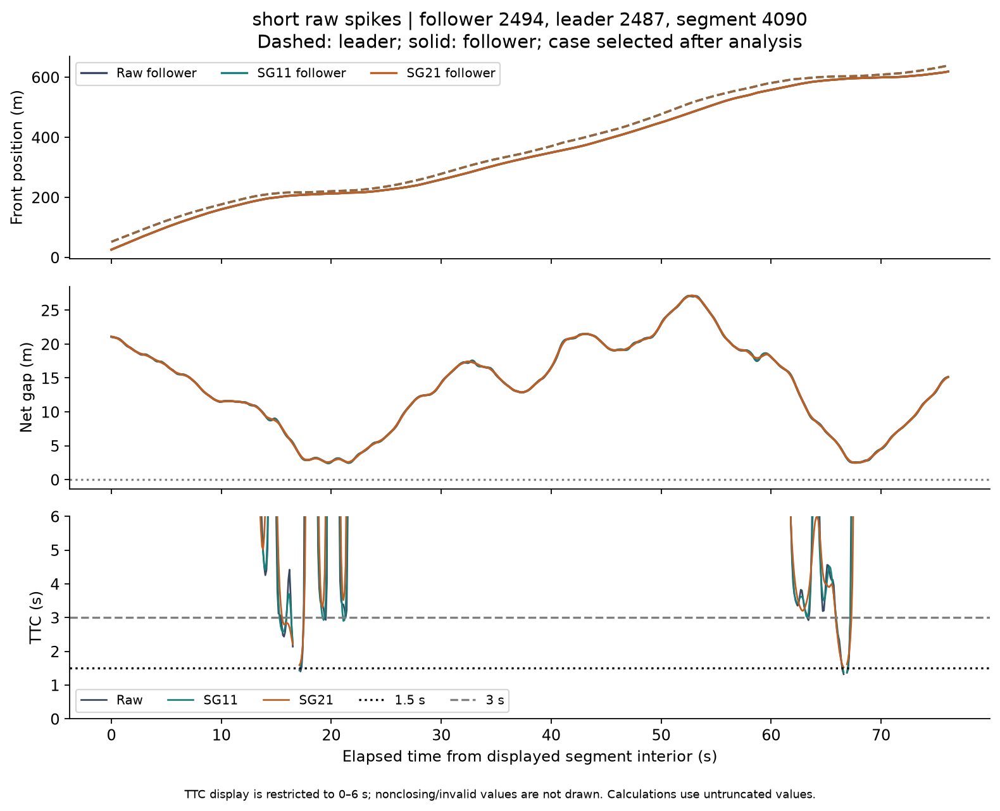

# Trajectory Smoothing and Traffic Conflict Detection

A reproducible computational research training project for Dezhang Li's Computer Science portfolio. **Computational study complete; student review and public release remain pending.** No remote repository has been created.

## Project Overview

How much does preprocessing change a traffic-conflict indicator? This project evaluates Raw positions and two Savitzky–Golay windows on one official NGSIM US-101 recording. It emphasizes consistent geometry, explicit exclusions, event matching and reproducibility. It does not predict observed crashes.

[English Research Report](report/RESEARCH_REPORT.md) · [Fixed protocol](docs/EXPERIMENT_PROTOCOL.md) · [Final results](results/final-20261021-r1/) · [Data provenance](data/manifest.json)

## Research Questions

1. How many low-TTC frames and persistent events are identified by each treatment?
2. How do smoothing windows change TTC distributions and event duration?
3. How does agreement change between TTC <1.5 s and <3.0 s?

## Dataset

[USDOT official NGSIM portal](https://data.transportation.gov/d/8ect-6jqj), original `trajectories-0750am-0805am.txt`: US-101, Los Angeles, 15 June 2005. The complete member contains 1,180,598 vehicle-frame rows and 2,169 vehicles. The strict local [07:50,08:05) window contains 1,165,200 rows. Only the necessary compressed member was acquired; no videos or other roads.

[Acquisition instructions, dictionary and licensing](data/README.md). Raw data are excluded from Git. Current portal CC BY-SA 3.0 and legacy RDE redistribution wording are disclosed separately.

## Methods

- Join a follower's preceding vehicle at the same frame/time; require same lane, reciprocal relationship, leader ahead and positive net bumper gap.
- Segment on relationship, lane and time discontinuities; no imputation.
- Raw / quadratic SG11 / quadratic SG21, applied to both vehicles. Derive velocity and gap from the corresponding positions.
- Use identical interior support, discarding eleven frames at both ends. Retain common validity across treatments: positive gap and speeds in [0,55] m/s.
- TTC is gap divided by positive closing speed; nonclosing is infinity. Count strict threshold crossings and events of ≥3 consecutive frames.
- Compare low-frame Jaccard and one-to-one overlapping events on the same pair segment.

## Key Results

The primary sample has **997,530 common valid frames across 3,944 segments**, covering 2,163 followers. Exclusions remove 14.39% of in-window rows. Negative smoothed speeds remove 12,177 frames from shared trimmed support.

| Treatment | Low frames <1.5 s | Events <1.5 s | Low frames <3 s | Events <3 s |
|---|---:|---:|---:|---:|
| Raw | 965 | 156 | 8,360 | 1,115 |
| SG11 | 889 | 136 | 7,861 | 981 |
| SG21 | 625 | 85 | 6,689 | 707 |

Raw–SG21 low-frame Jaccard is **0.516 / 0.634** at the two thresholds. Their matched event counts are **82 / 685**, with **74 / 430** Raw events unmatched and **3 / 22** SG21 events newly identified.

Smoothing reduces aggregate counts but also changes timing and merges episodes. It does not establish which detections are true. Selected examples include a pair whose low-frame count increases after smoothing. [Full summary](results/final-20261021-r1/summary.csv) · [Consistency](results/final-20261021-r1/consistency.csv).




## Reproduction

Verified on macOS 27.0.1 ARM64, Python 3.13.2. Other platforms have not been tested. Commands run from this P5 directory. Allow at least 2 GB free disk space; raw and derived arrays remain local. Python installation is a prerequisite.

```sh
python3 -m venv .venv
.venv/bin/python -m pip install --no-cache-dir -r requirements.txt
.venv/bin/python scripts/acquire.py
.venv/bin/python -m unittest discover -s tests -v
.venv/bin/python scripts/prepare.py
.venv/bin/python scripts/run.py --run-id my-reproduction
.venv/bin/python scripts/evaluate.py --run-id my-reproduction
.venv/bin/python scripts/plot.py --run-id my-reproduction
.venv/bin/python scripts/verify.py --run-id my-reproduction
```

Use a new run ID each time; `run.py` refuses to overwrite an existing run directory. Acquisition verifies existing files without re-downloading. Fresh acquisition requires the public official server to retain the recorded version and support HTTP byte ranges; the script fails on incompatible contents rather than silently using another dataset. No login is required at the verified endpoint. The dependencies were installed in this project's new virtual environment.

Optional real-data pilot: add `--pilot` to `run.py` with a distinct run ID, then evaluate and plot that ID. The pilot analyzed the first twenty eligible segments and found zero low-TTC events, as retained in [pilot summary](results/pilot-20261021/summary.csv).

On this local workspace, a second full run `reproduction-20261021` reproduced all **36 array columns and nine CSVs** exactly. Rescoring plus plotting reproduced **17 CSV/PNG files**. [Verification record](results/reproduction-20261021/verification.json). Fifteen unit tests passed. The arrays are deliberately not in Git; `--compare-to final-20261021-r1` works only where that baseline NPZ exists. Public users can compare generated CSVs with the included final CSVs directly.

## Repository Structure

- `src/ngsim/core.py` — pair geometry, segmentation, filtering, TTC and event matching.
- `scripts/` — bounded acquisition, preparation, execution, evaluation, plotting and verification.
- `tests/` — synthetic fixtures for definitions, not fabricated research data.
- `data/` — provenance and instructions; raw/interim/processed files excluded.
- `results/data/` — sample counts, exclusions, segments and diagnostics.
- `results/final-20261021-r1/` — authoritative derived summaries, events and real logs.
- `figures/final-20261021-r1/` — eight reproducible figures.
- `report/` — approximately 2,760-word main English report.
- `docs/` — current protocol and brief history; old unsigned gates are superseded for P5.

The original `final-20261021` run is retained locally but superseded. An explicit central difference fixed machine-scale negative speeds on stationary trajectories. No TTC thresholds or quality limits were changed. See [revision notes](results/README.md).

## Limitations

One road and fifteen minutes; dependent observations; no crash labels or independent trajectory truth. Original released coordinates are already video-derived. Filtering can remove meaningful dynamics and introduce negative velocities. Shared validity and boundary trimming limit coverage. TTC assumes constant longitudinal velocities and valid lane relationships. Finite-only distributions condition on different closing subsets; a common-finite supplement is included. Event matches permit temporal overlap, not identical boundaries. No causal, population-significance, production-safety or novel-algorithm claim is made.

## References

- [FHWA US-101 factsheet](https://www.fhwa.dot.gov/publications/research/operations/07030/)
- [Thiemann, Treiber & Kesting (2008)](https://doi.org/10.3141/2088-10)
- [Montanino & Punzo (2013)](https://doi.org/10.3141/2390-11)
- [Savitzky & Golay (1964)](https://doi.org/10.1021/ac60214a047)
- [FHWA SSAM report (2008)](https://www.fhwa.dot.gov/publications/research/safety/08051/02.cfm)

Complete references and attribution appear in the report. Original source code licensing is not yet selected; dataset licensing does not automatically license this code. Before public release the owner must confirm the file selection, attribution and intended code licence. This is a release decision, not a new research approval system.

## AI Assistance Disclosure

Codex/AI assisted with source inspection, implementation, execution, analysis and English drafting. Dezhang Li's personal understanding, contributions and final endorsement have not been independently confirmed. This is an unpublished research training report, not a claim of independent student programming or a peer-reviewed publication.
